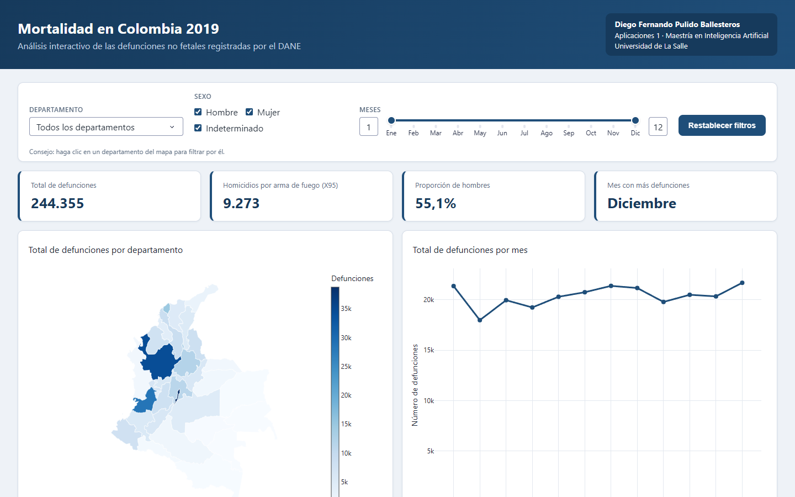
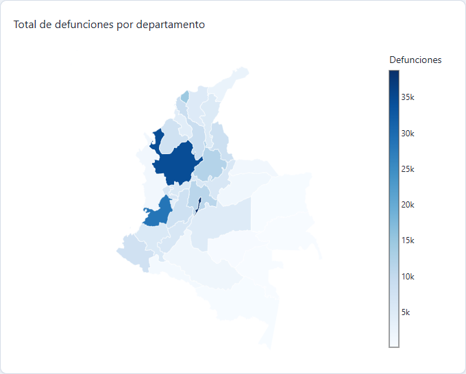
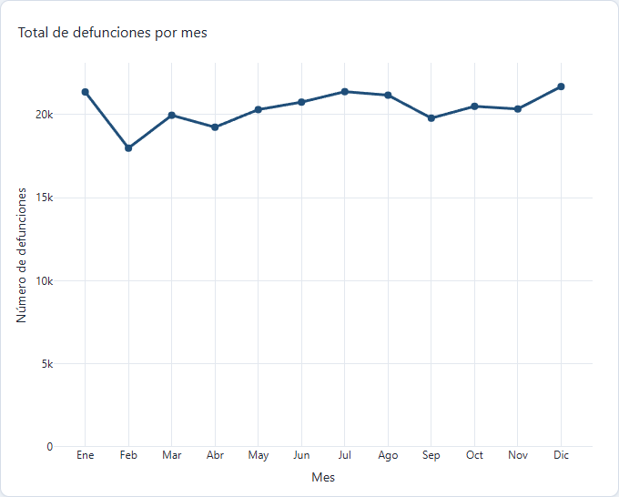
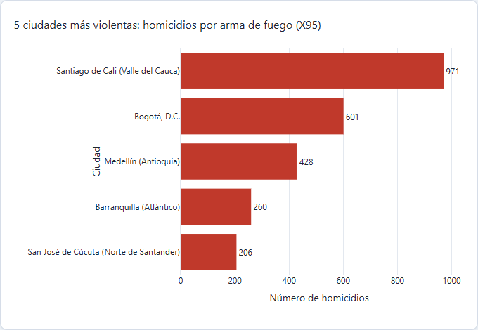
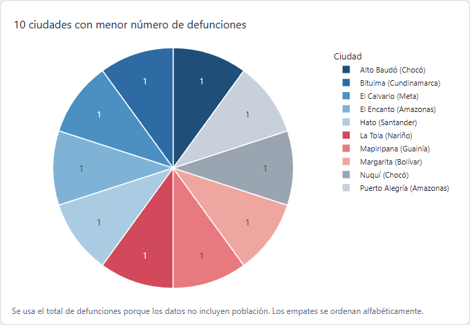
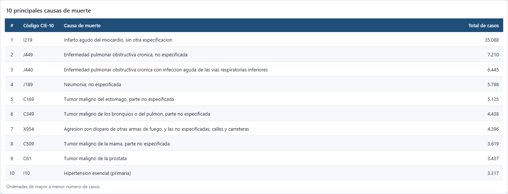
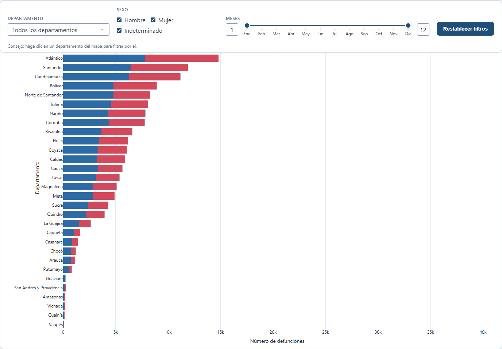
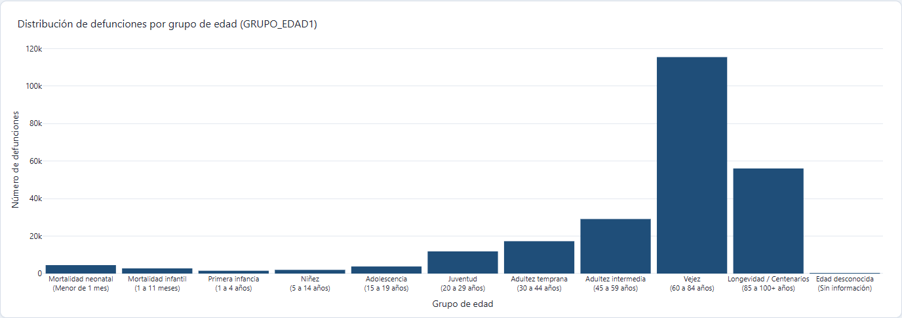
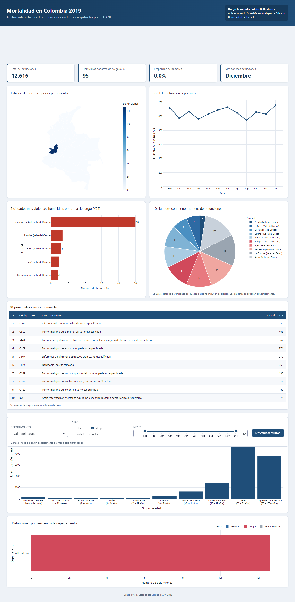

# Mortalidad en Colombia 2019

Este proyecto es un tablero web interactivo que hice con **Dash** y **Plotly** para analizar las defunciones no fetales que registró el DANE en 2019.

- **Autor:** Diego Fernando Pulido Ballesteros
- **Asignatura:** Aplicaciones 1 · Maestría en Inteligencia Artificial · Universidad de La Salle
- **Aplicación en línea:** <https://mortalidad-colombia-vzb6.onrender.com/>
- **Repositorio:** <https://github.com/DiegoBallesterosP/Actividad4_WebInteractiva>



## Introducción

En 2019 hubo 244.355 defunciones no fetales en Colombia, y la idea del tablero es poder explorar esos datos de forma sencilla con un mapa, varios gráficos y una tabla que cambian según los filtros de departamento, sexo y meses que uno escoja.

## Objetivo

Encontrar patrones demográficos, regionales y temporales en la mortalidad de Colombia durante 2019.

## Estructura del proyecto

```
mortalidad_colombia/
├── app.py               Punto de entrada
├── requirements.txt     Dependencias
├── render.yaml          Configuración de Render
├── assets/              Estilos
├── data/                Datos originales (raw) y procesados (processed)
├── mortality/
│   ├── data/            Limpieza y carga de datos
│   ├── analytics.py     Cálculos de cada visualización
│   └── ui/              Gráficos, diseño de la página e interactividad
└── tests/               Pruebas
```

## Requisitos

- Python 3.12 o superior
- Las librerías están en `requirements.txt`: dash 4.4.1, plotly 7.1.0, pandas 3.1.0, gunicorn 26.2.0 y openpyxl 3.1.5

## Instalación

Para correrlo en local:

```bash
git clone https://github.com/DiegoBallesterosP/Actividad4_WebInteractiva.git
cd Actividad4_WebInteractiva/mortalidad_colombia
python -m venv .venv
.venv\Scripts\activate          # en macOS / Linux: source .venv/bin/activate
pip install -r requirements.txt
python app.py
```

y luego se abre <http://127.0.0.1:8050> en el navegador.

## Despliegue

Publiqué la app en **Render** siguiendo estos pasos:

1. Subí el proyecto a un repositorio público de GitHub.
2. En [render.com](https://render.com) creé un **Web Service** conectado al repositorio, con `mortalidad_colombia` como **Root Directory**.
3. Render toma la configuración del archivo `render.yaml`:
   - **Build:** `pip install -r requirements.txt`
   - **Start:** `gunicorn app:server --workers 2 --timeout 120`
   - **Variable:** `PYTHON_VERSION = 3.12.8`

## Software

Python, Dash, Plotly, pandas, Gunicorn, Render, Git/GitHub y Visual Studio Code.

## Visualizaciones y resultados

Arriba del tablero hay tres filtros que siempre quedan visibles (departamento, sexo y rango de meses) y al cambiarlos se actualizan todos los gráficos, la tabla y los cuatro indicadores. También se puede hacer clic en un departamento del mapa para filtrar por él, y con el botón **Restablecer filtros** se vuelve a ver todo el país. Los datos que comento a continuación son de la vista nacional, sin ningún filtro.

### 1. Mapa: defunciones por departamento



Entre más oscuro el azul más defunciones tiene el departamento, y al pasar el mouse por encima aparece el nombre con su total.

**Hallazgos:** Bogotá (38.760), Antioquia (34.473) y Valle del Cauca (28.443) juntan el **41.6%** de las muertes del país, mientras que los que menos tienen son Vaupés (87), Guainía (115) y Vichada (188). Esto tiene sentido porque el mapa muestra totales y no tasas, así que básicamente sigue a la población.

### 2. Gráfico de líneas: defunciones por mes



**Hallazgos:** la mortalidad se mantiene bastante estable durante el año, entre 18.000 y 21.700 muertes por mes, siendo **diciembre** el mes más alto (21.678) y **febrero** el más bajo (17.974). Me llamó la atención febrero, pero en realidad baja sobre todo porque tiene menos días, ya que por día son 642 muertes contra 699 en diciembre. También se ven pequeños picos en enero, julio y diciembre que coinciden con las temporadas de vacaciones.

### 3. Gráfico de barras: las 5 ciudades más violentas



Para este gráfico conté los homicidios con código CIE-10 **X95** (agresión con disparo de armas de fuego y casos no especificados), que en todo el país fueron 9.273.

**Hallazgos:** **Santiago de Cali** está de primera con **971** homicidios, bastante más que Bogotá (601) a pesar de que Bogotá tiene más del triple de habitantes, y después vienen Medellín (428), Barranquilla (260) y Cúcuta (206). Entre las cinco suman el **26.6%** de los homicidios con arma de fuego del país, y el **93.5%** de las víctimas son hombres, casi todos entre 20 y 44 años.

### 4. Gráfico circular: las 10 ciudades con menor mortalidad



Como los datos del DANE no traen la población de cada municipio no pude calcular una tasa, entonces tomé como índice el **total de defunciones** de los municipios que tienen al menos una muerte registrada. Hay 13 municipios empatados con una sola defunción y en ese caso los ordené alfabéticamente.

**Hallazgos:** salen municipios muy pequeños o áreas no municipalizadas de la Amazonía y el Chocó, como Alto Baudó, El Encanto y Mapiripana, y que tengan una sola muerte puede ser porque tienen poca gente o porque hay **subregistro** en zonas tan apartadas. El gráfico se vuelve más útil al filtrar por departamento; por ejemplo, en Valle del Cauca muestra municipios con entre 3 y 17 defunciones.

### 5. Tabla: las 10 principales causas de muerte



**Hallazgos:** el **infarto agudo del miocardio** (35.088 casos) es la causa del **14.4%** de todas las muertes, casi cinco veces más que la segunda causa, la EPOC (7.210). La mayoría son enfermedades crónicas del corazón, respiratorias y cáncer, aunque el **homicidio con arma de fuego en la vía pública (X954)** aparece en el puesto 7, incluso por encima del cáncer de mama y de próstata.

### 6. Barras apiladas: defunciones por sexo y departamento



**Hallazgos:** el **55.1%** de las muertes son de hombres. En Bogotá (1.07 hombres por cada mujer) y Atlántico (1.11) la diferencia es poca, pero en Guaviare (3.4), Guainía (2.1) y Amazonas (1.9) es mucho más grande, seguramente porque allá pesan más las muertes violentas y por accidentes. Solo 93 registros tienen sexo indeterminado.

### 7. Histograma: defunciones por grupo de edad



Agrupé los códigos de `GRUPO_EDAD1` en las 11 etapas de la tabla de referencia, que van desde la mortalidad neonatal (códigos 0 a 4) hasta la edad desconocida (29).

**Hallazgos:** el **70.2%** de las muertes son de personas de 60 años o más, con la barra más alta en **Vejez, de 60 a 84 años** (115.453) seguida por la de 85 años o más (56.061). Algo que no esperaba es que la mortalidad neonatal (4.520) fuera mayor que la de primera infancia y niñez juntas, y entre los 20 y los 44 años se nota un aumento relacionado con las muertes violentas.

### Ejemplo de interacción



Si se filtra por **Valle del Cauca + Mujer** todo el tablero se recalcula: el total baja a **12.616** defunciones, los homicidios con arma de fuego quedan en 95, el cáncer de mama sube al **segundo lugar** de las causas y en el mapa solo queda resaltado ese departamento.

## Conclusiones

- En 2019 la mayoría de muertes fueron por **enfermedades crónicas en personas mayores**, con el infarto muy por encima de cualquier otra causa.
- La **violencia con armas de fuego** es algo muy marcado en Colombia, ya que está entre las 10 primeras causas, afecta sobre todo a hombres jóvenes y se concentra en ciudades como Cali.
- Las muertes se concentran en los departamentos con más población, así que para comparar regiones de forma justa habría que cruzar estos datos con las proyecciones de población del DANE y sacar tasas.

Fuente: [DANE, Estadísticas Vitales 2019](https://microdatos.dane.gov.co/index.php/catalog/696).
